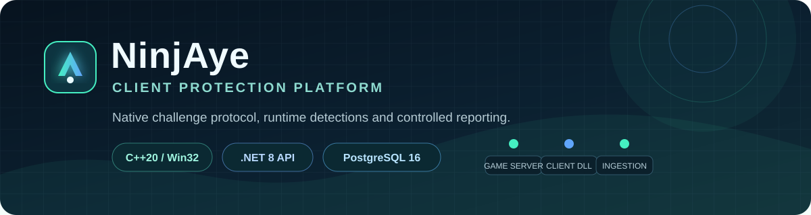
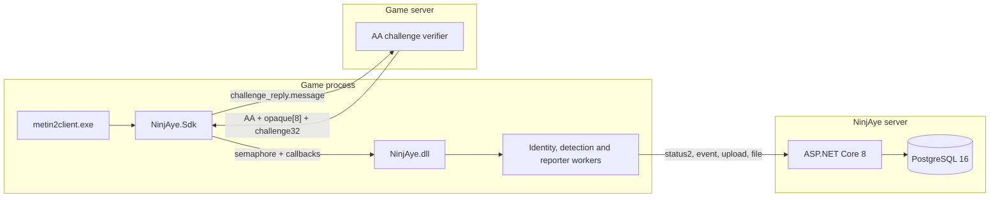
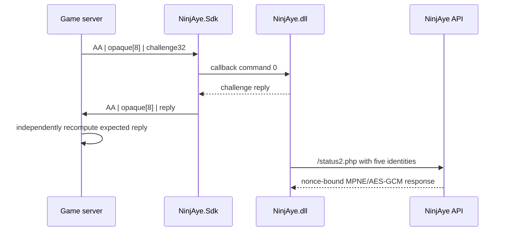

# NinjAye




NinjAye is a client protection platform built for defensive protocol analysis.
It combines a native Windows DLL,
a C++ integration SDK, a challenge/response protocol, runtime detection
reporting, an ASP.NET Core ingestion API and PostgreSQL storage.

The project contains no third-party API credentials, production endpoints or
game binaries. Development RSA keys and database passwords are
generated locally and are excluded from Git.

## What is included

| Component | Purpose |
| --- | --- |
| `NinjAye.dll` | Runtime protection worker, identity providers, detections, telemetry and report collection |
| `NinjAye.Sdk` | Small C++20 SDK for loading and starting the DLL through the bridge contract |
| `NinjAye.Example` | Executable demonstration of the game packet challenge path and server verification |
| `NinjAye.Server` | ASP.NET Core 8 API implementing the supported endpoint inventory |
| PostgreSQL schema | Sessions, installations, events, reports, detections and artifact metadata |
| End-to-end harness | Builds x64/Win32 clients, starts the stack and verifies every public route |

## Architecture



The game and the protection API are deliberately separate trust paths. The
game server verifies the `AA` challenge, while `NinjAye.dll` reports runtime
state to the protection API.

## Challenge lifecycle



The example verifies the callback result, the packet header and the opaque echo.
It also checks `challenge_reply.message` against the server-side calculation.
See [GC packet integration](docs/gc_packet.md) and
[wire protocol](docs/protocol.md) for the exact layouts.

## Repository layout

```text
NinjAye/
|-- client/
|   |-- dll/                Native NinjAye.dll
|   |-- sdk/                C++ SDK, bridge contract and packet example
|   `-- third_party/xorstr/ Vendored build-time string transform
|-- server/NinjAye.Server/  ASP.NET Core API
|-- database/               PostgreSQL schema
|-- docs/                   Protocol, deployment and security documentation
|-- scripts/                Local key and environment bootstrap
|-- tests/                  End-to-end integration harness
|-- NinjAye.sln             Visual Studio 2022 solution
`-- docker-compose.yml      API + PostgreSQL development stack
```

## Quick start

### Prerequisites

- Windows 10 or later;
- Visual Studio 2022 with the workloads from [`.vsconfig`](.vsconfig);
- MSVC v143, Windows SDK and .NET 8 SDK;
- Docker Desktop for the PostgreSQL-backed API;
- PowerShell 7 is recommended.

The native projects build as `Release|x64` and `Release|Win32`. The DLL project
automatically generates a local development key pair when one is missing.

### Build in Visual Studio

1. Clone or extract the repository.
2. Open [`NinjAye.sln`](NinjAye.sln).
3. Select `Release|x64` for a 64-bit client or `Release|Win32` for a 32-bit
   client.
4. Build the solution with **Build > Build Solution**.

Generated binaries are written to:

```text
build/<platform>/Release/ninjaye_sdk_example.exe
build/<platform>/Release/NinjAye.dll
build/<platform>/Release/NinjAye.Sdk.lib
```

For command-line builds, use a Visual Studio Developer PowerShell:

```powershell
pwsh .\scripts\generate-dev-keys.ps1
$solutionDirectory = (Resolve-Path .).Path.TrimEnd('\') + '\'
msbuild .\client\sdk\example\NinjAye.Example.vcxproj /m `
  /p:Configuration=Release /p:Platform=x64 `
  "/p:SolutionDir=$solutionDirectory"
msbuild .\client\sdk\example\NinjAye.Example.vcxproj /m `
  /p:Configuration=Release /p:Platform=Win32 `
  "/p:SolutionDir=$solutionDirectory"
```

### Start the API and PostgreSQL

```powershell
pwsh .\scripts\initialize-development.ps1
docker compose up --build
```

The bootstrap script creates:

- an ignored RSA-2048 development key pair;
- the generated public-key header consumed by the DLL;
- an ignored `.env` containing a random PostgreSQL password.

The API listens on `http://127.0.0.1:5088`. The private key is mounted into
the server container at runtime and is never copied into the Docker image.

For local execution without Docker:

```powershell
pwsh .\scripts\initialize-development.ps1
$env:NinjAye__Storage = "memory"
$env:NinjAye__PrivateKeyPath = (Resolve-Path .\config\ninjaye-dev-private.pem)
dotnet run --project .\server\NinjAye.Server\NinjAye.Server.csproj
```

### Run the executable example

```powershell
.\build\x64\Release\ninjaye_sdk_example.exe http://127.0.0.1:5088 --run-once
```

Expected challenge checks:

```text
AA challenge_reply.message == expected: OK
AA packet server verification: OK
```

## API surface

The HTTP host intentionally exposes only four POST routes.
There are no health, administration or versioned `/api` routes.

| Route | Request | Purpose |
| --- | --- | --- |
| `/status2.php` | MPNE: RSA-OAEP wrapped key + AES-256-GCM | Identity enrollment, status and nonce-bound session response |
| `/event.php` | exact 60-byte binary record | Cache/runtime event ingestion |
| `/upload.php` | multipart MPNE report envelope | Structured client, process and telemetry reports |
| `/file.php` | multipart field `file` | File submission after the configured process gate |

All submitted records are associated with a process-scoped session. The server
stores installation identity, event data, normalized report trees, detections
and artifact metadata. PostgreSQL fields use `jsonb` and GIN indexes where the
payload is naturally nested.

## Configuration

| Setting | Default | Description |
| --- | --- | --- |
| `NinjAye__Storage` | `memory` | Selects `memory` or `postgres` |
| `NinjAye__PrivateKeyPath` | required | RSA-2048 private PEM used by `/status2.php` |
| `ConnectionStrings__Postgres` | required for PostgreSQL | Npgsql connection string |
| `NinjAye__Reserved2__0` | empty | Exact MD5 gate for file collection |
| `NinjAye__Reserved50` | `262144` | Event mask returned in status responses |

Copy [`.env.example`](.env.example) only when manual environment management is
preferred. Production values belong in the deployment secret manager, never in
Git.

## Tests

The full harness requires Visual Studio, Docker and PostgreSQL support:

```powershell
$env:NINJAYE_PLATFORM_TOOLSET = "v143"
pwsh .\tests\run_end_to_end.ps1
```

It verifies:

- x64 and Win32 native builds;
- five hardware-derived identity callbacks;
- the 13-byte `AA` packet and `challenge_reply.message`;
- MPNE-authenticated `/status2.php` sessions;
- a controlled RX-region detection and `/upload.php`;
- the nested `ClientInformation` contract with MD5 image hash;
- exact `/event.php` cache records;
- `/file.php` multipart upload and SHA-256 persistence;
- cleanup in an isolated Compose project and volume.

Use `-SkipBuild`, `-SkipWin32` or `-KeepTestData` for focused local debugging.

## Security boundaries

- Third-party credentials and remote endpoints are not used.
- The client creates a new in-memory token and installation ID for each
  process lifecycle.
- The server stores only the SHA-256 hash of bearer tokens.
- The client waits for all five identity callbacks before startup completes.
- Unresolved detection predicates fail closed and do not emit speculative
  findings.
- File upload requires an exact configured process-list MD5 gate.
- Production traffic must terminate TLS at a trusted reverse proxy.
- No third-party DLLs, game executables, crash dumps or session captures belong
  in this repository.

Please read [SECURITY.md](SECURITY.md) before reporting a vulnerability.

## Documentation

- [Architecture](docs/architecture.md)
- [Protocol](docs/protocol.md)
- [Client integration](docs/integration.md)
- [Detections](docs/detections.md)
- [Database model](docs/database.md)
- [File submission](docs/file_submission.md)
- [Validation](docs/validation.md)
- [Publishing checklist](docs/publishing.md)
- [Third-party notices](THIRD_PARTY_NOTICES.md)

## Project status

NinjAye is a Windows-targeted protection platform. Its documented wire
contract, client bridge, detection pipeline and server behavior are covered by
the integration harness. Unsupported branches fail closed and are documented
rather than guessed.

## License

Copyright (c) 2026 NinjAye contributors. All rights reserved.

This repository is currently source-available for review and research. No
license is granted for redistribution or commercial use. The repository owner
must select a final license before public open-source publication. See
[LICENSE](LICENSE).
