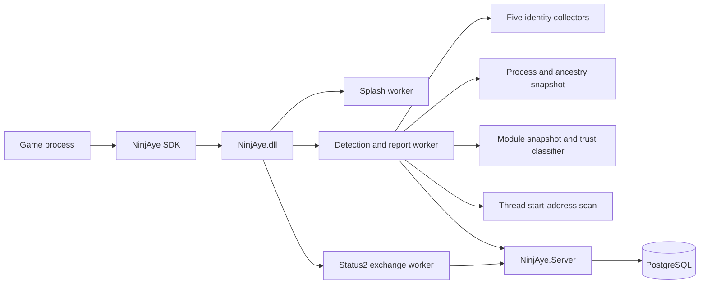

# Architecture



The SDK is a thin dynamic loader. It owns the semaphore configuration,
`LoadLibraryW` and the callback future. It does not resolve or invoke DLL
exports through `GetProcAddress`.

NinjAye.dll owns runtime state:

- one splash worker for visual initialization;
- one status2/cache-event compatibility loop;
- one detection/report loop;
- per-start in-memory enrollment identity;
- process, module, thread, signature and identity collection.

The single configured profile is compiled into `static_client_config.cpp`.
Marker `4D543254` selects `Mt2Test`, server ID `1`, and a full 32-bit challenge
mask. The SDK supplies the server URL through the client bridge configuration
during the semaphore handshake. Game name and worker intervals remain
compile-time values; the DLL has no environment-backed configuration path.

The server does not accept third-party API credentials. Every process start
creates a new NinjAye token and install ID in memory. The first authenticated
MPNE status request enrolls or refreshes the installation keyed by the
hardware-derived `ClientId`; PostgreSQL stores only the current token hash.

## Runtime sequence

1. The SDK allocates a low-address 24-byte client config and copies the
   `Local\NinjAye<PID>` semaphore name beside it.
2. The SDK calls `CreateSemaphoreExW` using `config_address >> 31` and
   `config_address & 0x7fffffff` as the two counts.
3. The first DWORD of the copied name is overwritten with marker `4D543254`.
4. The SDK loads `NinjAye.dll` without calling an Initialize export.
5. DLL attach starts the bridge worker.
6. The bridge opens the semaphore, queries class 0, decodes `MaximumCount`,
   reads the config pointer and callback, and validates the marker.
7. The bridge publishes callbacks in the documented order:
   `0, 5, 4, 3, 2, 1`.
8. Command0 completes the SDK readiness wait after publishing the challenge
   function. Command1 publishes the machine identity copy function.
9. The splash starts, then identity collection and the binary `/status2.php`
   exchange continue.
10. The detection worker sends MPNE reports to `/upload.php`, cache records to
    `/event.php` and approved raw payloads to `/file.php`.
11. `ninjaye_stop` joins workers.

## Challenge callback

The game calls the command0 function with a 32-bit challenge and sends the
returned DWORD in an `AA` 13-byte packet. NinjAye implements the documented
arithmetic:

```text
value = module_file_crc32c
value = mix(value, challenge)
value &= profile_mask
value = finish(value)
```

Before returning, optional integrity checks compare the mapped first-section
CRC32C and repeated challenge progress. Failures emit server-side events and
can request termination only when compiled with
`NINJAYE_CHALLENGE_ENFORCE`. That macro is enabled by default in the Visual
Studio project. Splash creation is controlled at compile time by
`NINJAYE_DISABLE_SPLASH`; runtime environment switches are not consulted.

## Identity callbacks

| Command | Published value |
|---|---|
| `1` | machine profile digest |
| `2` | CPU/disk/profile digest |
| `3` | TPM2 public-area digest |
| `4` | CPU/ProfileList SID digest |
| `5` | CPU/profile file-ID digest |

Each callback writes exactly 32 bytes and does not append a NUL.

## Data separation

The database separates:

- installation and token hashes;
- sessions and timestamps;
- discrete events;
- full reports;
- normalized detections;
- artifact bytes, metadata and hashes.

The complete MessagePack report is converted to JSON for retention while common
detection fields are also stored in a queryable table.
